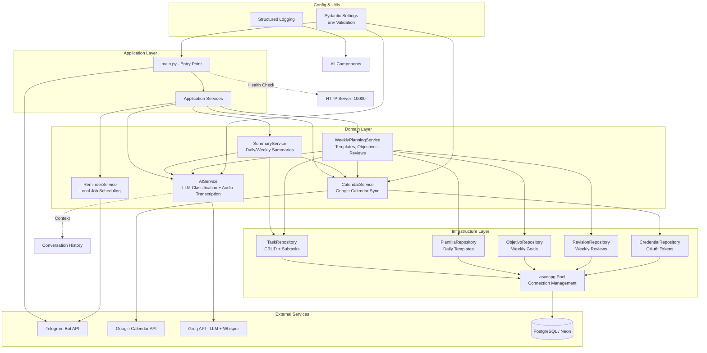

# Secretar-IA Architecture Flow Diagram

## High-Level System Architecture



## Message Processing Flow

```mermaid
flowchart TD
    START([User sends message]) --> VERIFY{Authorized User?}
    VERIFY -->|No| DENY[⛔ Access Denied]
    VERIFY -->|Yes| CMD{Is Command?}
    
    CMD -->|/start| START_HANDLER[start()\nWelcome + Register chat_id]
    CMD -->|/ayuda| AYUDA_HANDLER[ajuda()\nShow help guide]
    CMD -->|/test| TEST_HANDLER[test_sistema()\nSystem diagnostics]
    CMD -->|/calendar_status| CAL_STATUS[calendar_status()\nCalendar OAuth status]
    CMD -->|/notas| NOTAS_HANDLER[ver_notas()\nShow notes]
    CMD -->|/hoy| HOY_HANDLER[ver_hoy()\nToday's agenda]
    CMD -->|/semana| SEMANA_HANDLER[ver_semana()\nWeek agenda]
    CMD -->|/buscar| BUSCAR_HANDLER[buscar()\nSearch tasks/notes]
    CMD -->|/tag| TAG_HANDLER[filtrar_tag()\nFilter by tag]
    CMD -->|/pendientes| PEND_HANDLER[ver_pendientes()\nDaily tasks with subtasks]
    CMD -->|/plantillas| PLANT_HANDLER[ver_plantillas()\nManage templates]
    CMD -->|/objetivos| OBJ_HANDLER[ver_objetivos()\nManage objectives]
    CMD -->|/revision| REV_HANDLER[ver_revision()\nWeekly review]
    CMD -->|/resumen| RESUMEN_HANDLER[send_daily_summary()]
    
    CMD -->|Text Message| PROCESS[procesar_peticion()]
    CMD -->|Audio| AUDIO[recibir_audio()\nTranscribe → procesar_peticion()]
    
    PROCESS --> HELP_SHORTCUT{Help shortcut?}
    HELP_SHORTCUT -->|Yes| AYUDA_HANDLER
    HELP_SHORTCUT -->|No| CLASSIFY[ai_service.classify_intent()]
    
    CLASSIFY --> INTENT{ParsedIntent}
    
    INTENT -->|ERROR| ERR_RESP[Error response]
    INTENT -->|RECHAZADO_GASTOS| FIN_RESP[Finance rejection]
    INTENT -->|CONVERSACION| CONV_RESP[Natural chat response]
    INTENT -->|AYUDA| AYUDA_HANDLER
    INTENT -->|DESHACER| DESHACER[handle_deshacer()]
    INTENT -->|ELIMINAR_FECHA| ELIM_FECHA[handle_eliminar_fecha()]
    INTENT -->|REAGENDAR| REAGENDAR[handle_reagendar()]
    INTENT -->|LISTAR| LISTAR[handle_listar()]
    INTENT -->|BUSCAR| BUSCAR[handle_buscar()]
    INTENT -->|TAREA_DIARIA| TAREA_DIA[handle_guardar_tarea_diaria()]
    INTENT -->|PLANTILLA_CREAR| PLANT_CREAR[handle_crear_plantilla()]
    INTENT -->|PLANTILLA_LISTAR| PLANT_LIST[handle_listar_plantillas()]
    INTENT -->|PLANTILLA_ACTIVAR| PLANT_ACT[handle_activar_plantilla()]
    INTENT -->|OBJETIVO_CREAR| OBJ_CREAR[handle_crear_objetivo()]
    INTENT -->|OBJETIVO_LISTAR| OBJ_LIST[handle_listar_objetivos()]
    INTENT -->|OBJETIVO_PROGRESO| OBJ_PROG[handle_progreso_objetivo()]
    INTENT -->|REVISION_SEMANAL| REV_SEM[handle_revision_semanal()]
    INTENT -->|EVENTO/RECORDATORIO/NOTA| GUARDAR[handle_guardar_tarea()]
    
    GUARDAR --> SAVE_DB[task_repo.save()]
    SAVE_DB -->|EVENTO| SYNC_CAL[calendar_service.create_event()]
    SYNC_CAL --> UPDATE_DB[task_repo.update_task(calendar_event_id)]
    SAVE_DB -->|RECORDATORIO| SCHED_REM[reminder_service.schedule_reminder()]
    SAVE_DB --> RESPONSE[_build_confirmation_message()]
    
    DESHACER --> LAST_TASK[task_repo.get_last_task()]
    LAST_TASK --> DEL_CAL{Has calendar_event_id?}
    DEL_CAL -->|Yes| CAL_DEL[calendar_service.delete_event()]
    DEL_CAL -->|No| DEL_DB[task_repo.delete_by_id()]
    CAL_DEL --> DEL_DB
    
    REAGENDAR --> FIND_TASK[Find task by ID or similarity]
    FIND_TASK -->|EVENTO| CAL_UPDATE[calendar_service.update_event()]
    FIND_TASK --> CAL_CREATE{No event_id?}
    CAL_CREATE -->|Yes| CAL_CREATE_EVT[calendar_service.create_event()]
    CAL_CREATE_EVT --> UPDATE_TASK[task_repo.update_task()]
    CAL_UPDATE --> UPDATE_TASK
    
    TAREA_DIA --> PARSE_ITEMS[Parse items by comma/and/newline]
    PARSE_ITEMS --> CREATE_SUBTASKS[Create SubTask objects]
    CREATE_SUBTASKS --> SAVE_DAILY[task_repo.save(TAREA_DIARIA)]
    SAVE_DAILY --> BUTTONS[Create InlineKeyboard buttons]
    
    CALLBACK[callback_completar()] -->|complete_| COMPLETE[task_repo.complete()]
    CALLBACK -->|delete_| DELETE[task_repo.delete_by_id() + cal delete]
    CALLBACK -->|subtask_| SUBTASK[task_repo.complete_subtask()]
    SUBTASK --> REFRESH[Refresh message with updated state]
    
    RESPONSE --> SEND[Send to Telegram]
    ERR_RESP --> SEND
    FIN_RESP --> SEND
    CONV_RESP --> SEND
    
    DENY --> END([End])
    SEND --> END
```

## Scheduled Jobs Flow

```mermaid
flowchart TD
    STARTUP[post_init()] --> INIT_DB[init_db()]
    INIT_DB --> CREATE_SERVICES[Create all services]
    CREATE_SERVICES --> JOBS[Register Jobs]
    
    JOBS --> JOB1[Daily 06:30 - apply_daily_template()]
    JOBS --> JOB2[Daily 06:50 - enviar_resumen_diario()]
    JOBS --> JOB3[Daily 18:00 - send_evening_reminder()]
    JOBS --> JOB4[Weekly Sun 10:00 - send_weekly_review()]
    JOBS --> JOB5[Every 5min - keep_alive_db SELECT 1]
    
    JOB1 --> WEEK_SVC[weekly_planning_service]
    WEEK_SVC --> PLANT_REPO[plantilla_repo.get_active()]
    PLANT_REPO --> TASK_SAVE[task_repo.save(TAREA_DIARIA)]
    
    JOB2 --> SUM_SVC[summary_service.send_daily_summary()]
    SUM_SVC --> TASK_REPO[task_repo.get_pending()]
    SUM_SVC --> CAL_SVC[calendar_service.get_upcoming_events()]
    SUM_SVC --> AI_SVC[ai_service.generate_proactive_suggestion()]
    
    JOB3 --> SUM_SVC2[summary_service.send_evening_reminder()]
    
    JOB4 --> WEEK_SVC2[weekly_planning_service.send_weekly_review()]
    WEEK_SVC2 --> REV_REPO[revision_repo.save()]
    WEEK_SVC2 --> OBJ_REPO[objetivo_repo.get_active()]
    WEEK_SVC2 --> TASK_REPO2[task_repo.get_completed_this_week()]
    WEEK_SVC2 --> CAL_SVC2[calendar_service.get_upcoming_events()]
    
    JOB5 --> POOL[asyncpg Pool]
    POOL --> FETCH[fetchval SELECT 1]
```

## Database Schema

```mermaid
erDiagram
    TAREAS ||--o{ PLANTILLAS_DIARIAS : ""
    TAREAS ||--o{ OBJETIVOS_SEMANALES : ""
    TAREAS ||--o{ REVISIONES_SEMANALES : ""
    TAREAS ||--o{ CREDENCIALES : ""
    
    TAREAS {
        serial id PK
        text telefono_id
        text tipo "EVENTO, RECORDATORIO, NOTA, TAREA_DIARIA"
        text detalles
        timestamptz fecha_hora
        text estado "PENDIENTE, COMPLETADO"
        timestamptz creado_en
        timestamptz actualizado_en
        text recurrencia "RRULE string"
        integer prioridad "-1, 0, 1"
        text[] tags
        text calendar_event_id
        jsonb subtareas "[{id, texto, completado, orden}]"
    }
    
    CREDENCIALES {
        serial id PK
        text nombre UK "google_calendar"
        text token_json
        timestamptz actualizado_en
    }
    
    PLANTILLAS_DIARIAS {
        serial id PK
        text telefono_id
        text nombre
        jsonb items_json "[{texto, orden}]"
        boolean activa
        timestamptz creado_en
        timestamptz actualizado_en
        UK(telefono_id, nombre)
    }
    
    OBJETIVOS_SEMANALES {
        serial id PK
        text telefono_id
        text descripcion
        numeric objetivo_valor
        text objetivo_unidad "horas, veces, libros, km"
        date semana_inicio "Monday of week"
        numeric valor_actual DEFAULT 0
        timestamptz creado_en
        timestamptz actualizado_en
        UK(telefono_id, semana_inicio, descripcion)
    }
    
    REVISIONES_SEMANALES {
        serial id PK
        text telefono_id
        date semana_inicio
        jsonb resumen_json "{tareas_completadas, eventos, objetivos, plantillas_usadas, notas}"
        timestamptz creado_en
    }
```

## AI Classification Pipeline

```mermaid
flowchart LR
    INPUT[User Text] --> PROMPT[Build System Prompt]
    PROMPT --> CONTEXT[Add Conversation Context\n(last 5 interactions)]
    CONTEXT --> LLM[Groq LLM\nqwen/qwen3.8-27b\nJSON mode, temp=0]
    LLM --> PARSE[Parse JSON Response]
    PARSE --> NORMALIZE[_normalize_result()]
    NORMALIZE --> FALLBACK{Date missing?}
    FALLBACK -->|Yes| REGEX[_parse_relative_date()\nRegex patterns]
    FALLBACK -->|No| VALIDATE[Validate Enums & Types]
    REGEX --> VALIDATE
    VALIDATE --> OUTPUT[ParsedIntent Dataclass]
    
    OUTPUT --> ACTION{Action Type}
    ACTION -->|EVENTO| EVT[Requires fecha_hora]
    ACTION -->|RECORDATORIO| REM[Requires fecha_hora]
    ACTION -->|NOTA| NOT[No fecha_hora]
    ACTION -->|TAREA_DIARIA| DAILY[No fecha_hora, subtareas]
    ACTION -->|PLANTILLA_CREAR| PLANT[No fecha_hora]
    ACTION -->|OBJETIVO_CREAR| OBJ[valor + unidad]
    ACTION -->|REAGENDAR| REAG[tarea_original_id]
    
    STYLE LLM fill:#f9f,stroke:#333
    STYLE REGEX fill:#ff9,stroke:#333
```

## Key Design Patterns Used

1. **Repository Pattern** - Data access abstraction (TaskRepository, PlantillaRepository, etc.)
2. **Service Layer** - Business logic encapsulation (AIService, CalendarService, etc.)
3. **Dependency Injection** - Services instantiated in `post_init`, passed where needed
4. **Async/Await** - Full async architecture with asyncpg, aiohttp
5. **Structured Logging** - JSON logging with context (structlog-style)
6. **Configuration as Code** - Pydantic Settings with validation
7. **Circuit Breaker** - AIService checks availability before calls
8. **Conversation Context** - AIService maintains last 10 interactions
9. **Graceful Degradation** - Calendar sync failures don't block local save
10. **Idempotent Migrations** - ALTER TABLE IF NOT EXISTS on startup